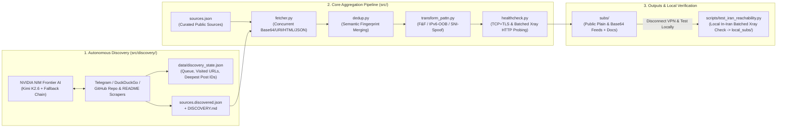

# PattN Architecture Overview

PattN combines automated multi-source aggregation, AI-driven feed discovery, semantic deduplication, DPI bypass variant synthesis, strict zero-leak privacy isolation, and real-traffic local ISP verification.

## High-Level Data Flow

## Module Responsibilities

| Module | Responsibility |
|---|---|
| `src/models.py` | Data structures (`ProxyNode`, `SourceConfig`, `SourceStats`), semantic fingerprinting, and formatted remarks. |
| `src/parsers.py` | Multi-format parsers (`vless`, `vmess`, `trojan`, `ss`, `hy2`, `tuic`, Base64, Telegram `/s/` HTML, Xray JSON). |
| `src/fetcher.py` | Concurrent fetching merging `sources.json` and `sources.discovered.json`. |
| `src/dedup.py` | Merges duplicate endpoints across providers while unioning tags and `source_ids`. |
| `src/transform_pattn.py` | Generates PattN bypass variants (`F&F`, `IPv6-OOB`, `SNI-Spoof`). |
| `src/healthcheck.py` | Prioritized socket verification plus batched multi-round HTTP-proxied Xray probing (`blackhole` fallback guard). |
| `src/categorizer.py` | Emits categorized `subs/` feeds and updates `README.md` / `STATUS.md`. |
| `src/discovery/` | Autonomous search & Telegram/GitHub/OCR discovery loop backed by `data/discovery_state.json`. |
| `scripts/test_iran_reachability.py` | Local Windows verifier using PattN's `xray.exe` to probe configs directly through your Iranian ISP (`local_subs/`). |
| `scripts/sync_to_pattn.py` | Safely backs up and upserts PattN Hub subscriptions into `guiNDB.db`. |

## CI Automation Cadence

- **`.github/workflows/ci.yml`**: Runs Python compilation checks (`compileall`), unit/integration tests across Python 3.10 & 3.12, and secret scans on every push & PR.
- **`.github/workflows/update-subs.yml`**: Runs every 6 hours (`0 */6 * * *`) for fast scheduled source aggregation, multi-platform categorization, docs update, and security checks (without AI discovery overhead).
- **`.github/workflows/daily-deep-discovery.yml`**: Runs daily (`0 2 * * *`) for an autonomous 500-request frontier AI deep crawl exploring new channels and configs, serialized via `concurrency: pattn-git-writer`.
