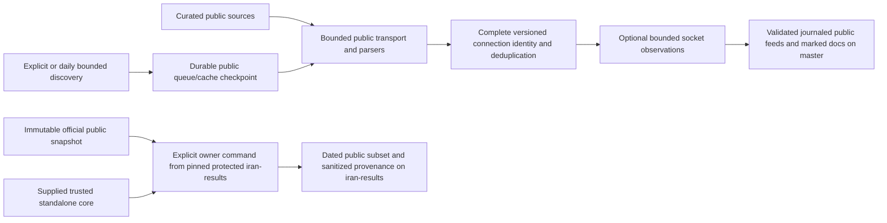

# NavaRoute architecture

NavaRoute publishes validated public URI subscriptions, not executable core configurations or client integration. Source claims, dated socket reachability and dated owner end-to-end observations are separate contracts.

## Maintained responsibilities

| Surface | Responsibility |
|---|---|
| `src/network.py`, `src/fetcher.py` | Bounded transport with public destination/DNS/redirect controls, authenticated model boundary kept separate; validated public registry/cache inputs. |
| `src/models.py`, `src/parsers.py`, `src/dedup.py` | Complete fingerprint version 1, lossless supported connection parsing/serialization, source-claim merging. No manufactured variants. |
| `src/healthcheck.py` | Optional scheduled socket observations; standalone faithful owned-core probes only on explicit owner use. A TCP socket is not credential verification; unsupported UDP/core settings cannot pass by fallback. |
| `src/categorizer.py` | Bounded render/round-trip/count validation before journaled replacement; stale owned country reconciliation; static README outside unique markers; one snapshot timestamp. Does not publish owner evidence. |
| `src/discovery/` | Bounded requests/retries/redirects/channels and network deadlines; durable child/parent queue progress and public cache/source/checkpoint reconciliation. Model/OCR results are untrusted inputs, not guaranteed yield. |
| `src/storage.py` | Atomic public checkpoint/file replacement; interrupted journals recover before later publication. Process-interruption recovery is not power-loss durability. |
| `scripts/public_git.py` | Quiet all-tracked/index privacy and exact final staged-role checks; bounded non-forced master rebase/push, nonzero on conflict/exhaustion. No private worktree reads. |
| `scripts/test_iran_reachability.py`, `src/iran_results.py` | Reviewed protected-branch import pinning, actual owner/admin authorization, immutable public snapshot, explicitly supplied standalone core, sanitized dated public-subset evidence and owner API publication. |

## Formats and evidence

Plain feeds have comment headers plus one URI per row; Base64 pairs encode only those rows. Headers use NavaRoute profile titles. Core JSON export is retired to `[]`. Consumers must separately support the protocol and complete supplied parameters; no native-core/universal-import guarantee is made.

`all` means accepted public connections, `lite500` is protocol-balanced up to 500, `reachable` is only actual qualifying socket observations for the emitted context, and `top100` is the reachable pool ranked by measured connection latency. Legacy `verified` mirrors reachable, **not** credentials or end-to-end proof. `categories/navaroute-special` selects supplied parameters; only `categories/pattn-special` retains an old-brand raw alias. Country, whitelist, ConfigsHUB and the legacy `iran-optimized` labels are upstream claims, not measured location/routing/bypass.

Snapshot dates are emission/input context dates, separate from owner UTC test dates. Historical offline migration has `healthcheck_ran=false`, all observation status untested and empty reachable/top/verified feeds. It reuses validated tracked public input, never private files or fabricated fresh probes/crawl statistics. [Migration ledger](MIGRATION.md) records hashes, counts and exclusions.

## Writers and authorization boundary

Six-hour aggregation (`0 */6 * * *`) and daily discovery (`0 2 * * *`) stay on `master` with one shared `navaroute-git-writer` Actions group. Default daily ceilings: 500 actual model HTTP requests including retries/fallbacks, 5400 discovery network seconds and 2000 channels. Ceilings are not minimum work/yield promises. Discovery failure stops the workflow; publication has an explicit public staging list, quiet final index gate and non-forced retry. Human commits are rebased, not reset/overwritten; conflicts and five exhausted push attempts fail.

Local/custom publishers must also be single-writer per output directory, and discovery checkpoint publishing single-writer per state directory. Recovery journals make interrupted replacement recoverable, not safe for simultaneous writers. Local commands are outside Actions concurrency; operators must serialize them.

CI declares unrestricted push/PR triggers (no generated/security path exclusions or skip-CI messages), with shallow non-persisted-credential checkout and pinned checkout/setup-python Actions. GitHub normally suppresses new workflow triggers for `GITHUB_TOKEN` pushes; scheduled writers execute their own tests and final staged privacy gate. No downstream CI execution is claimed for those pushes. Writer jobs explicitly need `contents: write`; tests only need `contents: read`. Persisted credentials are disabled. Neither environment omission nor final path checks make `GITHUB_TOKEN` path-scoped: it is a repository token, not an executable-code isolation boundary.

Required release boundary: the independent protected `iran-results` branch must contain the supported tester, **all imports** and publication validation/upload code. Bootstrap must come from a trusted reviewed pin there, never unprotected scheduled `master`. Non-admin writers must require code-owner review; the intentional owner-admin exception is `enforce_admins=false`. Actions PR creation/approval stays blocked; no Iran/bot PR workflow or automation admin bypass is permitted. Only actual `mani-moh` owner-admin API authorization plus explicit direct-ISP/access-review attestations and `--publish` may use this path. Physical location/packet origin and the completeness of App/secret enumeration remain trust limits.

The repository rename, protected setup, remote CI/enforcement and owner's first real core/ISP run are **pending coordinator/owner release checks**, not verified by local offline tests. Patterniha/Xray-core attribution, source identities, copyright and historical audit references are preserved. No client process, DB, installation, registry or user directory is accessed or migrated.
